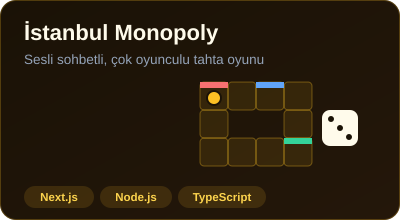

  

  
  
  
  

**Kısaca:** Beykent Üniversitesi'nde Bilgisayar Mühendisliği okudum. **.NET** ile iş uygulamaları, **Next.js** ile modern web arayüzleri geliştiriyorum. ERP danışmanlığı ve veri analizi deneyimim var. Bir işi baştan sona, yani veritabanından canlıya kadar kendim götürmeyi seviyorum.

- 🏥 Sağlık ve klinik yönetim yazılımları: randevu, hasta takibi, raporlama
- 🏢 Kurumsal web siteleri, yönetim panelleri ve e-ticaret
- 🎮 Gerçek zamanlı, çok oyunculu web oyunları
- 📊 Veriyi rapora ve karara dönüştürmek: Python, SQL, Power BI, Zoho Analytics

## Öne çıkan projeler

  
  
  

| Proje | Ne yapıyor | Teknoloji |
| :--- | :--- | :--- |
| [PortfoyGo](https://github.com/yasingulsoy/PortfoyGo) | 100.000 ₺ sanal bakiyeyle hisse, kripto, döviz ve emtia al-sat; liderlik tablosunda yarış | Next.js 16, Express, PostgreSQL |
| [İstanbul Monopoly](https://github.com/yasingulsoy/monopoly) | Lobi, sesli sohbet ve canlı oyun tahtasıyla çok oyunculu İstanbul temalı tahta oyunu | Next.js, Node.js, TypeScript |
| [E-Ticaret](https://github.com/yasingulsoy/E-TicaretBitirmeProje) | Sepet, favoriler, Iyzico ödeme ve tam yönetim paneli olan bitirme projesi | ASP.NET Core MVC, EF Core, SQL Server |
| [Sertifikalar](https://github.com/yasingulsoy/Certificates) | AWS, siber güvenlik, ağ, C# ve veri analizi sertifikalarım | — |

## Deneyim

| Nerede | Rol | Ne yaptım |
| :--- | :--- | :--- |
| **Cloudyflex · Zoho** (2024) | ERP Danışmanı, .NET Geliştirici | Müşteriye özel ERP çözümleri; ASP.NET Core MVC ile web uygulamaları; Zoho Analytics ve Power BI ile raporlama |
| **Beykent Üniversitesi · Öğrenci Dekanlığı** | Web Master, Jr. Veri Analisti | Kurumsal sitelere yeni ekranlar; kayıt, tercih ve rakip analizi raporları |
| **Beykent Üniversitesi · Bilgisayar Mühendisliği Kulübü** | Kulüp Başkanı | Teknik ve sosyal etkinlikler, sektör gezileri, kulübün tanıtım stratejisi |

## Teknolojiler

<strong>Backend</strong>

 

<strong>Frontend ve mobil</strong>

 

<strong>Veri</strong>

 

<strong>Altyapı ve araçlar</strong>

 

## Katkı grafiğim

  <picture>
    <source media="(prefers-color-scheme: dark)" srcset="https://raw.githubusercontent.com/yasingulsoy/yasingulsoy/output/github-snake-dark.svg" />
    <source media="(prefers-color-scheme: light)" srcset="https://raw.githubusercontent.com/yasingulsoy/yasingulsoy/output/github-snake.svg" />
    
  </picture>

  

